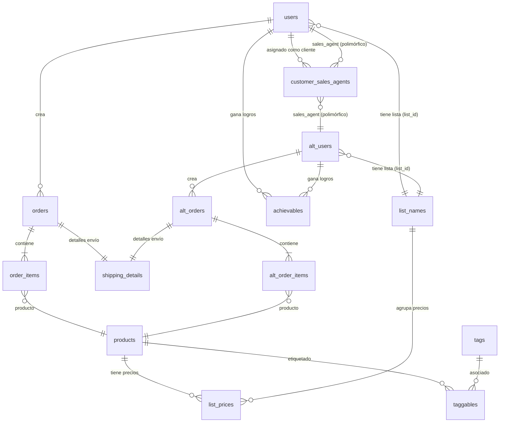

# Arquitectura Integral del Sistema OAGO: Tareas, Atributos, Métodos y Relaciones

OAGO es una plataforma de comercio electrónico B2B (TALL Stack: Tailwind CSS, Alpine.js, Laravel 12, Livewire 3 / Volt SFC) con sincronización bidireccional ERP mediante API REST.

---

## 1. Mapa de Actores y Tareas Principales

```
+---------------------------------------------------------------------------------------+
|                                    ACTORES DEL SISTEMA                                |
+---------------------------------------------------------------------------------------+
        |                                   |                              |
        v                                   v                              v
   [ ADMINISTRADOR ]                 [ VENDEDOR (SALES) ]         [ CLIENTE / INVITADO ]
   - Gestión integral del catálogo    - Impersonación de cliente   - Consulta de catálogo
   - Precios y listas promocionales   - Gestión de cartera asignada - Precios por lista
   - Sincronización ERP / Logs        - Emisión de pedidos formal   - Carrito y Checkout
   - Temas, Sliders y Settings        - Vista de órdenes emitidas   - Historial y Puntos
```

### Matriz de Tareas por Capa
| Módulo / Dominio | Tareas Backend (PHP / Laravel / Services) | Tareas Frontend (Livewire Volt / MaryUI / Alpine) |
| :--- | :--- | :--- |
| **Autenticación & Sesión** | Guard `web` vs `alt`. `real_user()` vs `current_user()`. Limpieza de sesión al rotar. Middleware `check_guest`. | Formularios reactivos de Login y Registro (`register.blade.php`), contador visual de días de prueba restantes (`WebNavbar`). |
| **Impersonación Comercial** | Selección de cartera en `ManagesCustomers`. Enlace en `customer_sales_agents`. Carrito aislado por prefijo `web_` / `alt_`. | Dropdown de clientes asignados en `WebNavbar`, búsqueda debounce en vivo, visualización de vendedor con icono `o-users`. |
| **Catálogo & Precios** | `ProductSearchService`, `PriceListService`. Resolución de lista base, unidad (`U`) y promoción (`promo_list_id`). Tags en `taggables`. | Grid reactiva `WebSearchFilter`, tarjetas `WebProductCard` con modal rápido, vista detallada `web-product-detail`. |
| **Carrito & Pedidos** | `OrderService::placeOrder()`. Transiciones seguras de `OrderStatus`. Generación de `Order` o `AltOrder` y `ShippingDetail`. | Carrito en drawer/página (`cart.blade.php`), persistencia en sesión, validación de stock y checkout en tiempo real. |
| **Gestión Administrativa** | Sincronización API (`UserController`, `ListPriceController`), importación masiva de imágenes (`ImageImportService`). | Paneles CRUD unificados con `ManagesModelCrud` (`users`, `alts`, `products`, `lists`, `tags`, `themes`, `settings`). |

---

## 2. Diagrama de Relaciones de Datos (Entidad - Relación)



---

## 3. Clases Principales: Atributos y Métodos

### A. Modelos de Autenticación y Usuarios

```
+-------------------------------------------------------------------------------------+
| User (Tabla: users) [Guard: web, sanctum]                                          |
+-------------------------------------------------------------------------------------+
| ATRIBUTOS:                                                                          |
| - id: int (ERP primary key)       - name: string(30)       - lastname: string(30)   |
| - email: string(255)              - password: string(hashed)- phone: string(50)      |
| - address: string(100)            - city: string(30)       - postal_code: string(10)|
| - role: Role (admin, sales, etc.) - list_id: ?int (FK)     - is_internal: bool      |
| METODOS Y RELACIONES:                                                               |
| + orders(): HasMany<Order>                                                          |
| + latestOrder(): HasOne<Order>                                                      |
| + assignedSalesAgents(): HasMany<CustomerSalesAgent>                                |
| + assignedCustomers(): MorphMany<CustomerSalesAgent>                                |
| + getManagedCustomersQuery(): Builder                                               |
| + getFullNameAttribute(): string                                                    |
| + getProductPrice(Product): ?float                                                  |
+-------------------------------------------------------------------------------------+

+-------------------------------------------------------------------------------------+
| AltUser (Tabla: alt_users) [Guard: alt]                                             |
+-------------------------------------------------------------------------------------+
| ATRIBUTOS:                                                                          |
| - id: int (Auto-increment)        - name: string(30)       - lastname: ?string(30)  |
| - email: string(255)              - password: string(hashed)- phone: ?string(50)     |
| - activation_token: ?string(100)  - role: Role (guest, customer, sales)             |
| - list_id: ?int (FK)              - is_internal: bool                               |
| METODOS Y RELACIONES:                                                               |
| + orders(): HasMany<AltOrder>                                                       |
| + latestOrder(): HasOne<AltOrder>                                                   |
| + assignedCustomers(): MorphMany<CustomerSalesAgent>                                |
| + getManagedCustomersQuery(): Builder                                               |
| + getFullNameAttribute(): string                                                    |
+-------------------------------------------------------------------------------------+
```

---

### B. Catálogo, Listas y Precios

```
+-------------------------------------------------------------------------------------+
| Product (Tabla: products)                                                           |
+-------------------------------------------------------------------------------------+
| ATRIBUTOS:                                                                          |
| - id: int (ERP code)              - name: string(255)      - description: ?text     |
| - barcode: ?string(100)           - price: decimal(12,2)   - stock: int             |
| - published: bool                 - featured: bool         - visibility: string     |
| - image_url: ?string              - qtty_package: int      - bonus_qtty: ?int       |
| METODOS Y RELACIONES:                                                               |
| + listPrices(): HasMany<ListPrice>                                                  |
| + tags(): MorphToMany<Tag>                                                          |
| + syncTagsById(array): void                                                         |
| + syncTagsBySlug(array): void                                                       |
| + getMediaAttribute(): array (Caché WebP + YouTube thumbs)                          |
| + hasBonus(): bool                                                                  |
| + getBonusLabelAttribute(): string (ej. "23 + 1 off !!")                            |
+-------------------------------------------------------------------------------------+

+-------------------------------------------------------------------------------------+
| PriceListService (Servicio de Precios)                                              |
+-------------------------------------------------------------------------------------+
| METODOS:                                                                            |
| + resolveListId(?Model $user): ?int                                                 |
| + getBasePrice(?int $listId, Product $product): ?float                              |
| + getPromoPrice(?int $listId, Product $product, ?float $basePrice): ?float          |
| + getEffectivePrice(?Model $user, Product $product): ?float                         |
| + getPricesForProducts(?Model $user, Collection|array $productIds): Collection      |
+-------------------------------------------------------------------------------------+
```

---

### C. Pedidos y Checkout

```
+-------------------------------------------------------------------------------------+
| Order / AltOrder (Tablas: orders / alt_orders)                                      |
+-------------------------------------------------------------------------------------+
| ATRIBUTOS:                                                                          |
| - id: int                         - user_id / alt_user_id: int                      |
| - status: OrderStatus             - total: decimal(12,2)   - notes: ?text           |
| - is_paid: bool                   - payment_method: ?string                         |
| METODOS Y RELACIONES:                                                               |
| + items(): HasMany<OrderItem | AltOrderItem>                                        |
| + shipping(): HasOne<ShippingDetail>                                                |
| + user(): BelongsTo<User | AltUser>                                                 |
| + placeOrder(array $shippingData): self                                             |
+-------------------------------------------------------------------------------------+

+-------------------------------------------------------------------------------------+
| OrderService (Servicio de Procesamiento de Órdenes)                                |
+-------------------------------------------------------------------------------------+
| METODOS:                                                                            |
| + placeOrder(array $items, array $shipping, ?Model $customer = null): Order|AltOrder|
| + calculateTotals(array $items): array{subtotal: float, discount: float, total: ...}|
| + transitionStatus(Order|AltOrder $order, OrderStatus $newStatus): bool             |
| + notifyCustomer(Order|AltOrder $order): void                                       |
+-------------------------------------------------------------------------------------+
```

---

## 4. Componentes Frontend (Livewire Volt & MaryUI)

```
+-------------------------------------------------------------------------------------+
| COMPONENTES PRINCIPALES Y SU INTERACCIÓN                                           |
+-------------------------------------------------------------------------------------+

 [WebNavbar] ---------------------> [WebSearchFilter] -------------> [WebProductCard]
 - Selector de Cartera Clientes     - Input reactivo debounce       - Visualización producto
 - Identidad Vendedor [o-users]     - Filtros por categoría / Tags  - Cálculo de precio cliente
 - Carrito badge contador           - Ordenamiento y paginación     - Modal detalle rápido
        |                                                                   |
        v                                                                   v
   [Cart Drawer / Page] <----------------------------------------- [Add to Cart Event]
   - Listado de items reactivo                                      - Dispatch Livewire
   - Control de unidades y bultos cerrados                          - Feedback con Mary Toast
        |
        v
   [Checkout]
   - Selección de dirección y transporte
   - Validación de datos fiscales
   - Emisión de orden vía OrderService
```

### Traits de Componentes (Reutilización de Código)
- **`ManagesModelCrud`**: Provee `$formData`, `$newPassword`, validación centralizada vía `HasProfileData::getProfileRules()`, carga de datos, guardado, cambio de clave y eliminación tanto para `User` como para `AltUser`.
- **`ManagesModelIndex`**: Gestiona `$search`, ordenamiento multi-columna `$sortBy`, consultas paginadas unificadas con filtrado en `name`, `lastname` y `email`, y reseteo automático de páginas.
