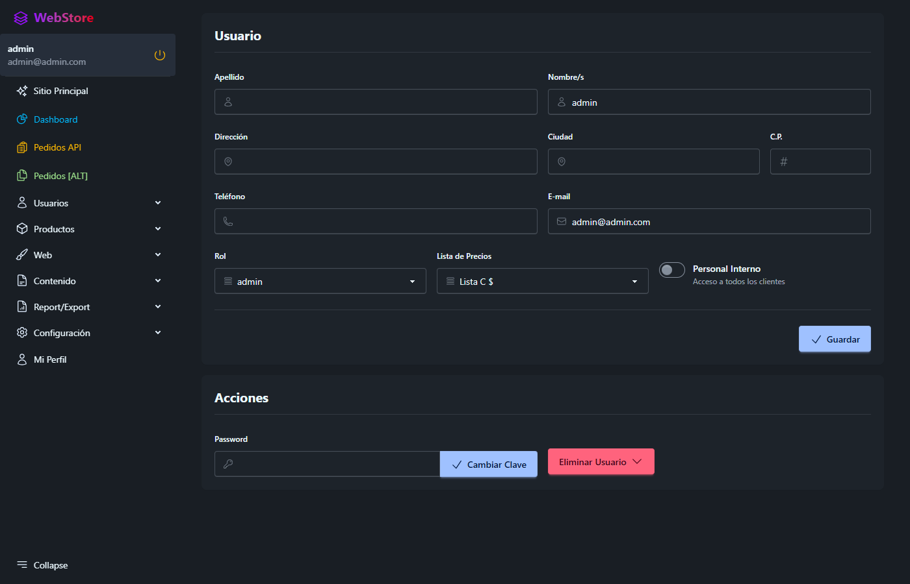
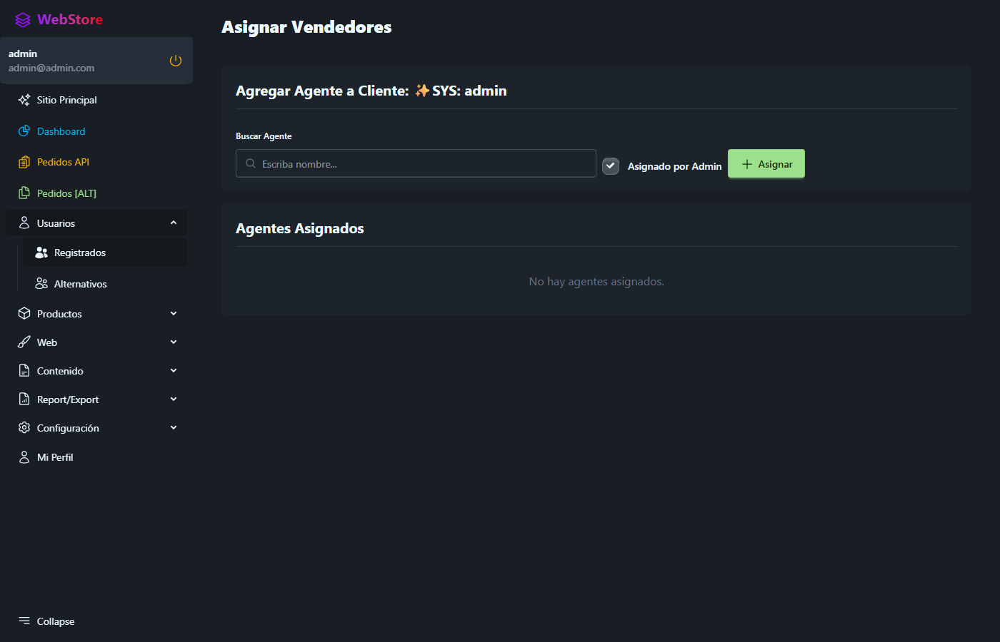
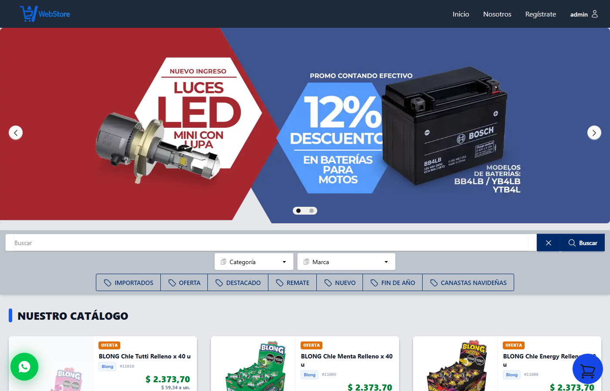
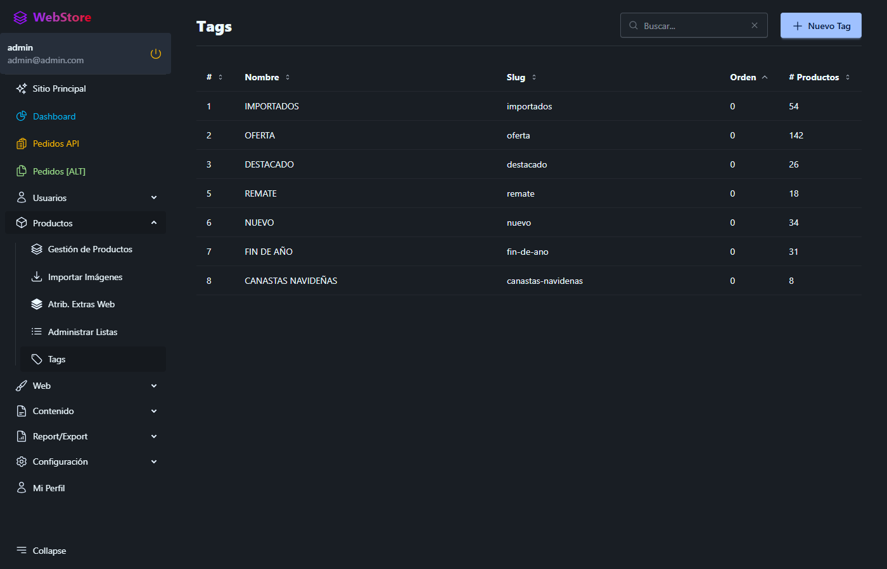
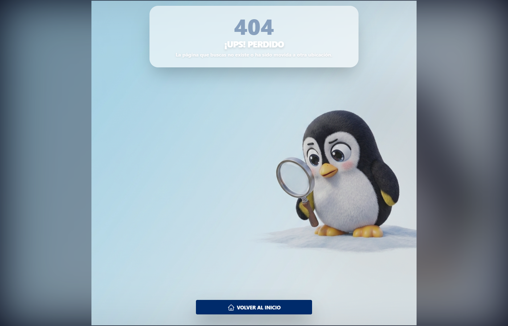

# Guía de Funcionalidades: Vendedores, Impersonalización y Tags en OAGO

Esta documentación detalla el funcionamiento del módulo de vendedores (rol `sales`), los dos mecanismos para listar clientes en la barra de navegación, la persistencia de identidad durante la impersonalización y las mejoras implementadas en el sistema relacional de etiquetas (**Tags**).

---

## 1. Acceso y Visibilidad de Clientes en la Barra de Navegación

Cuando un usuario con rol `sales` (o `admin`) inicia sesión, el sistema analiza qué cartera de clientes tiene habilitada para gestionar e impersonalizar en el catálogo.

Existen **dos caminos** para que un vendedor pueda ver a los clientes en el selector de la barra de navegación:

```
                                 ┌──────────────────────────────────────────────┐
                                 │ ¿El vendedor tiene "Personal Interno" activo? │
                                 └──────────────────────┬───────────────────────┘
                                                        │
                           ┌────────────────────────────┴───────────────────────────┐
                           │ SÍ                                                     │ NO
                           ▼                                                        ▼
              ┌──────────────────────────┐                             ┌──────────────────────────┐
              │ Visualiza a TODOS los    │                             │ Visualiza ÚNICAMENTE los │
              │ clientes del sistema     │                             │ clientes asignados       │
              └──────────────────────────┘                             └──────────────────────────┘
```

---

### Camino 1: Asignación Individual desde cada Cliente (`customer`)

Este enfoque permite delegar clientes específicos a uno o más vendedores particulares.

1. Como Administrador, ingrese a **Usuarios** (`/users`).
2. Edite el usuario que posee rol **`customer`** (`/user/{id}`).
3. En la esquina inferior izquierda del formulario de edición, observará el botón destacado **"Asignar Vendedores"**.
4. Al ingresar a la vista de asignación (`/users/{id}/sales-assign`), se listan los vendedores disponibles para marcar y desmarcar su asignación directa.


*Figura 1: Vista de edición de un cliente donde se habilita el botón "Asignar Vendedores".*


*Figura 2: Selector interactivo para asignar uno o más vendedores a la cuenta del cliente.*

---

### Camino 2: Switch "Personal Interno" en Usuarios Vendedores (`sales`)

Para vendedores de planta o personal interno que requieren atender o cotizar a cualquier cliente sin necesidad de asignaciones manuales una a una:

1. Ingrese a **Usuarios** (`/users`) y edite el perfil del vendedor (`/user/{id}`).
2. Active el switch **"Personal Interno"** (`is_internal = true`).
3. Al guardar los cambios, el método `getManagedCustomersQuery()` del trait `ManagesCustomers` otorgará acceso global inmediato a todos los usuarios con rol `customer`.

> **Lógica en el Modelo (`App\Traits\ManagesCustomers`):**
> ```php
> public function getManagedCustomersQuery(): Builder
> {
>     if ($this->is_internal || $this->role === Role::ADMIN) {
>         return User::where('role', Role::CUSTOMER);
>     }
> 
>     return User::whereHas('assignedSalesAgents', function ($query) {
>         $query->where('sales_agent_id', $this->id)
>             ->where('sales_agent_type', self::class);
>     });
> }
> ```


*Figura 3: Conmutador "Personal Interno" en el formulario de usuario.*

---

## 2. Experiencia en la Barra de Navegación e Impersonalización

### Persistencia del Nombre de Usuario Logueado
Anteriormente, al impersonalizar a un cliente para realizar un pedido a su nombre, el dropdown de perfil cambiaba erróneamente mostrando el nombre del cliente.

**Comportamiento actual:**
- El menú de usuario de la derecha **mantiene siempre la identidad del vendedor logueado** utilizando el helper `real_user()` y el ícono `o-users`.
- El cliente seleccionado se refleja claramente a la izquierda en el botón desplegable de clientes: `Cliente: Apellido, Nombre`.
- La función de búsqueda (`wire:model.live.debounce="searchCustomer"`) permite filtrar clientes rápidamente en tiempo real.


*Figura 4: Barra de navegación mostrando el selector de cliente a la izquierda y el usuario autenticado a la derecha.*

---

## 3. Mejoras en el Manejo de Etiquetas (Tags)

El sistema de tags fue refactorizado a un modelo **estrictamente relacional** para eliminar inconsistencias y garantizar persistencia sólida:

1. **Tabla `taggables` como Única Fuente de Verdad:**
   - Se eliminó la antigua columna plana `products.tags` y la configuración legacy `product_tags`.
   - Se implementó un índice único compuesto en `taggables` para prevenir duplicados.
2. **Administración Centralizada:**
   - Gestión completa de etiquetas desde `/tags` (creación, edición de slugs y eliminación segura con purga en cascada).
3. **Selección Dinámica en Productos:**
   - En la edición de productos (`/product/{id}`), los tags se administran con un selector `<x-choices>` conectado al catálogo relacional y cacheado para óptimo rendimiento.
4. **Búsqueda Avanzada de Productos:**
   - La búsqueda en el catálogo por texto incluye coincidencias directas con los nombres de tags asociados mediante subconsultas SQL optimizadas en `ProductSearchService`.


*Figura 5: Pantalla de administración centralizada de Tags (`/tags`).*


*Figura 6: Selector de tags múltiples en la ficha técnica de producto.*
